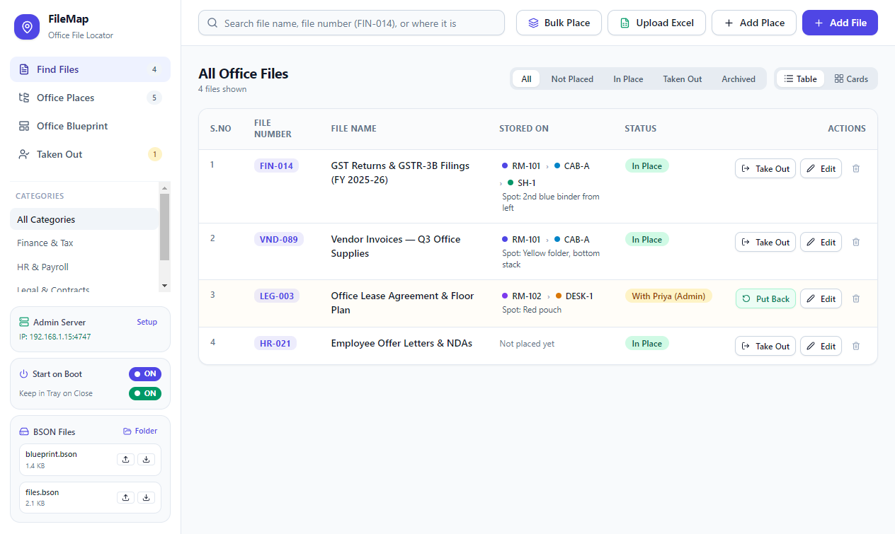
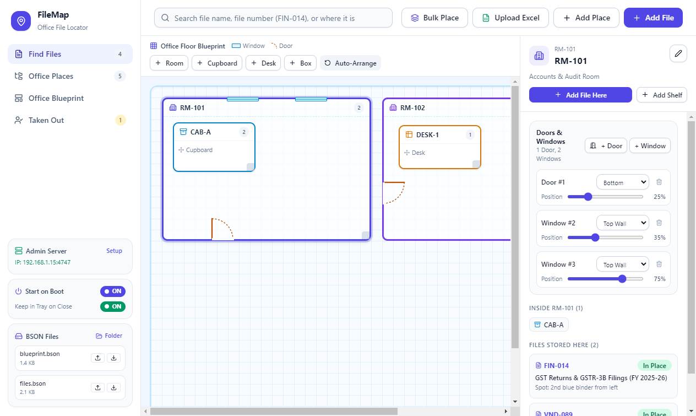
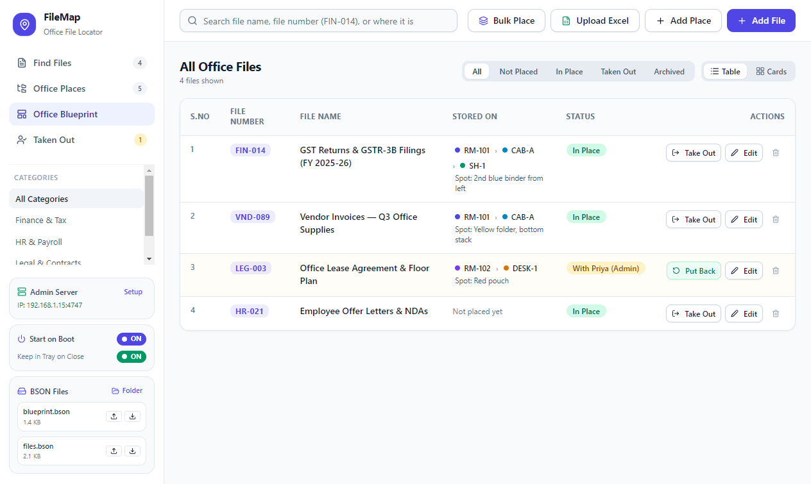
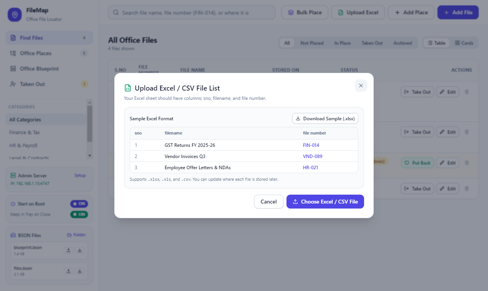
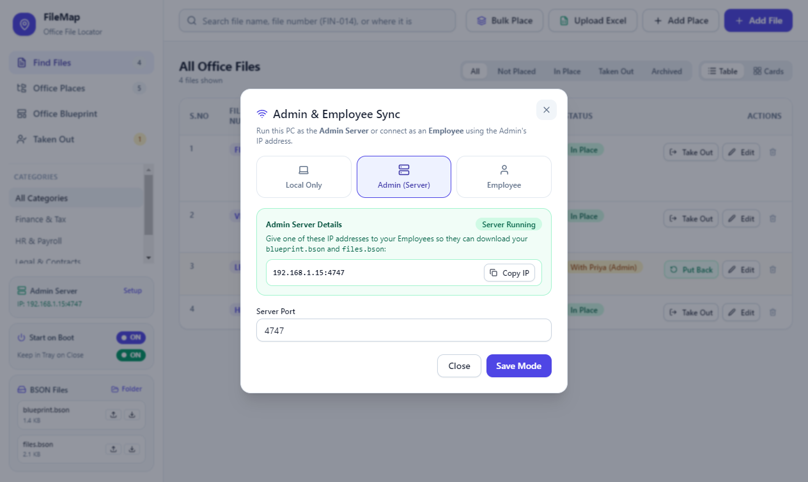

# FileMap — Office Physical File Locator

**FileMap** is a cross-platform desktop application (Windows, macOS, Linux) built with **Electron, React, TypeScript, Tailwind CSS, and shadcn/ui** to help offices track exactly where physical files, binders, and folders are stored—persisted in binary **BSON** files (`blueprint.bson` and `files.bson`).

---

## Screenshots

### 1. Find Files & Instant Search
Search by **File Number**, **File Name**, **Stored On** location, or **Taken Out** person, and switch between Table and Card views.



### 2. Interactive Office Blueprint (Rooms, Doors, Windows & Cupboards)
Design your real office floor plan by dragging and resizing **Rooms**, **Cupboards**, **Desks**, and **Boxes** on a snap-to-grid blueprint. Add **Doors** and **Windows** to any wall with exact position sliders.



### 3. Bulk Update "Stored On" by File Numbers
Paste comma-separated File Numbers (`FIN-014, VND-089, HR-021`), preview matched files, and assign their **Stored On** location all at once.



### 4. Upload Excel / CSV (with Sample Template & Preview)
Download a sample `.xlsx` template or upload your existing Excel/CSV sheet (`sno`, `filename`, `file number`), preview rows, swap columns if needed, and import straight into `files.bson`.



### 5. Admin (Server) & Employee (Client) LAN Sync
Run one PC as the **Admin Server** and connect **Employee** PCs using the Admin's IP address. Employees can download `blueprint.bson` and `files.bson` and continue working even if the Admin PC goes offline—changes are queued in `sync-queue.bson` and automatically synced when Admin comes back online.



---

## How It Works

### 1. Separate BSON Databases
All data is stored locally in binary `.bson` files inside your app data folder:
- **`blueprint.bson`**: Office rooms, doors, windows, cupboards, shelves, desks, boxes, and floor-plan coordinates.
- **`files.bson`**: File records (`S.No`, `File Number`, `File Name`, `Stored On`, `Exact Spot`, `Status`, `Taken Out By`).
- **`sync-queue.bson`**: Offline changes queued on Employee PCs when Admin is unreachable.
- **`app-settings.bson`**: Startup and system-tray preferences.

You can **Import**, **Export**, or open the data **Folder** directly from the sidebar.

### 2. Map Your Office & Draw the Blueprint
1. Open **Office Blueprint** or **Office Places** in the sidebar.
2. Add **Rooms** (e.g., `RM-101`), then add **Cupboards**, **Desks**, **Shelves**, or **Boxes** inside them using short codes (`CAB-A`, `SH-1`).
3. Drag and resize items on the blueprint grid to match your office layout, and add **Doors** and **Windows** in the right-hand inspector.

### 3. Add or Import Files
- **Single File**: Click **+ Add File** and enter `S.No`, `File Number`, `File Name`, and `Stored On`.
- **Excel / CSV Import**: Click **Upload Excel** to download a sample `.xlsx` or upload your own sheet. You can leave **Stored On** empty during import and filter by **Not Placed** later.
- **Bulk Place**: Click **Bulk Place** to assign **Stored On** to many existing files at once using comma-separated File Numbers.

### 4. Track Who Took a File
Click **Take Out** on any file and enter the person's name/desk. The file appears under **Taken Out** until someone clicks **Put Back**.

### 5. Admin & Employee Office Sync
- **On Admin PC**: Click **Setup** in the sidebar → select **Admin (Server)** → **Save Mode**. Share the displayed LAN IP and port (default `4747`) with employees.
- **On Employee PC**: Click **Setup** → select **Employee** → enter Admin's IP → click **Download BSON from Admin**.
- **Offline Support**: If Admin is offline, employees can keep adding/updating files; changes are saved locally and queued in `sync-queue.bson`, then automatically pushed every 8 seconds once Admin is back online.

### 6. Background Start & System Tray
Toggle **Start on Boot** (`ON` / `OFF`) and **Keep in Tray on Close** (`ON` / `OFF`) in the sidebar so FileMap runs quietly in the system tray when your computer starts.

---

## Development & Build

```bash
# Install dependencies
bun install

# Run in development mode (Vite + Electron)
bun run dev

# Typecheck and build production bundle
bun run tsc --noEmit
bun run vite build

# Package installer for current OS (Windows / macOS / Linux)
npx electron-builder
```

Pre-built installers for **Windows (`.exe`)**, **macOS (`.dmg`)**, and **Linux (`.AppImage`)** are built automatically via GitHub Actions in [.github/workflows/release.yml](.github/workflows/release.yml) and published on the [Releases](https://github.com/RishiBose961/FILE-MAP/releases) page.
